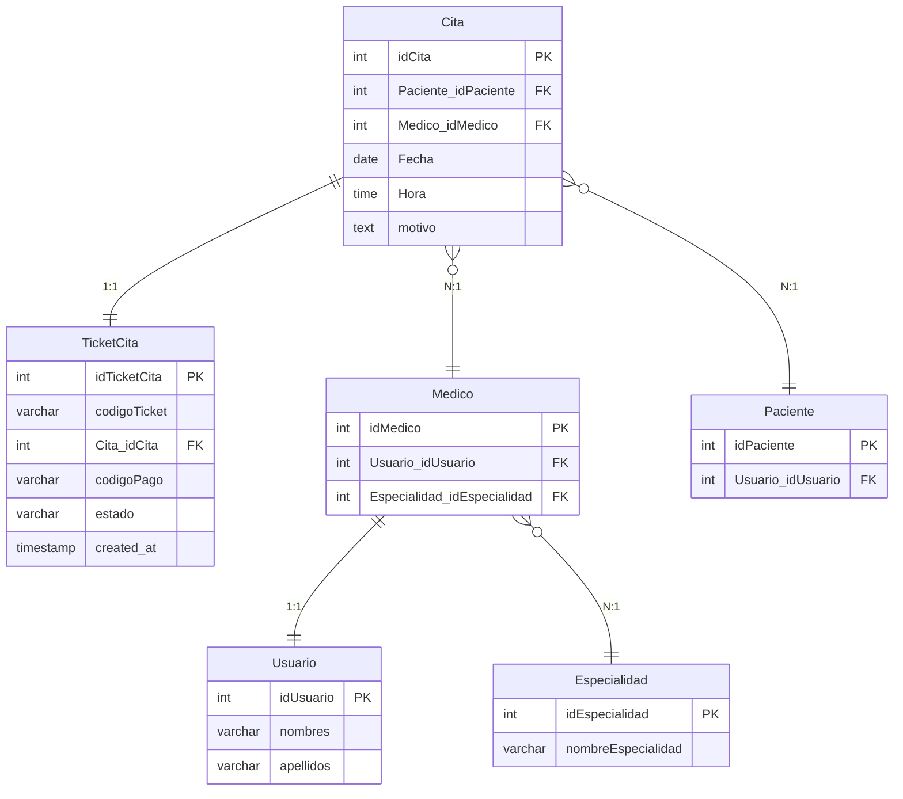
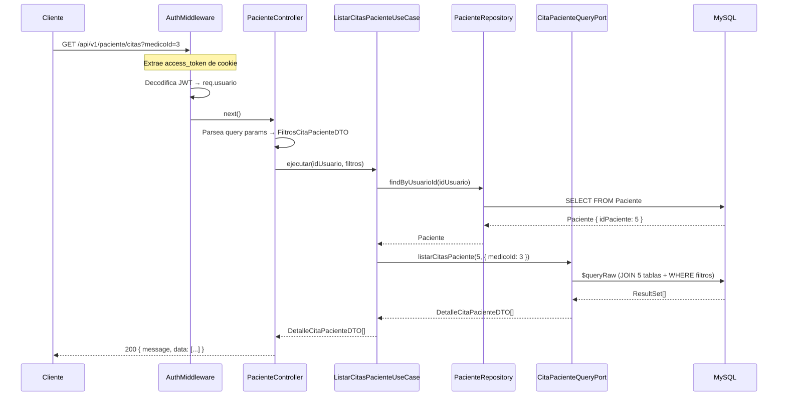

# 📋 Spec: ListarCitasPacienteUseCase

> **Propósito**: Especificación de implementación para el caso de uso `ListarCitasPacienteUseCase`, que permite a un paciente autenticado listar sus citas médicas con detalle enriquecido (JOIN de 4 tablas) y filtros opcionales.

> [!IMPORTANT]
> Esta spec es un contrato entre Antigravity (arquitectura) y Kilo Code (implementación). Kilo Code debe implementar **todos** los archivos listados, siguiendo los patrones existentes del proyecto.

---

## 1. Contexto del proyecto

### 1.1 Arquitectura
El proyecto sigue **Clean Architecture** con esta estructura de capas y regla de dependencia:

```
Infrastructure/Main → Presenter → Application → Domain
```

### 1.2 Stack tecnológico
- **Runtime**: Node.js + TypeScript
- **Framework HTTP**: Express.js
- **ORM**: Prisma (MySQL)
- **Testing**: Vitest
- **Auth**: JWT en cookies HttpOnly (`access_token`)

### 1.3 Patrones establecidos

| Patrón | Referencia |
|---|---|
| **Controller** | [AuthController.ts](file:///c:/Users/CODECTA04/Desktop/Sistema%20Medico/Backend-Citas-Medicas/src/presenter/rest/controller/AuthController.ts) |
| **Routes** | [Auth.routes.ts](file:///c:/Users/CODECTA04/Desktop/Sistema%20Medico/Backend-Citas-Medicas/src/presenter/rest/routes/Auth.routes.ts) |
| **Factory (DI)** | [AuthFactory.ts](file:///c:/Users/CODECTA04/Desktop/Sistema%20Medico/Backend-Citas-Medicas/src/infrastructure/di/factories/AuthFactory.ts) |
| **SharedContainer** | [SharedContainer.ts](file:///c:/Users/CODECTA04/Desktop/Sistema%20Medico/Backend-Citas-Medicas/src/infrastructure/di/SharedContainer.ts) |
| **Middleware Auth** | [AuthMiddleware.ts](file:///c:/Users/CODECTA04/Desktop/Sistema%20Medico/Backend-Citas-Medicas/src/presenter/rest/middleware/AuthMiddleware.ts) |
| **Exception** | [BaseException.ts](file:///c:/Users/CODECTA04/Desktop/Sistema%20Medico/Backend-Citas-Medicas/src/application/exception/BaseException.ts) |
| **DTO** | [AuthDTO.ts](file:///c:/Users/CODECTA04/Desktop/Sistema%20Medico/Backend-Citas-Medicas/src/application/dto/AuthDTO.ts) |
| **Port** | [JwtGenerator.ts](file:///c:/Users/CODECTA04/Desktop/Sistema%20Medico/Backend-Citas-Medicas/src/application/port/JwtGenerator.ts) |

---

## 2. Modelo de datos relevante

### 2.1 Tablas involucradas (4 tablas + 1 tabla pivote)



### 2.2 Relación TicketCita:Cita

> [!WARNING]
> El schema Prisma actual define `TicketCita` como `1:N` con `Cita` (`tickets TicketCita[]`). Sin embargo, la regla de negocio establece que es **1:1**. El schema Prisma NO necesita modificarse para esta implementación ya que usaremos `$queryRaw`, pero ten en cuenta esta relación es semánticamente 1:1.

---

## 3. Query SQL

La consulta base usa `$queryRaw` de Prisma para ejecutar un JOIN de 5 tablas:

```sql
SELECT 
  c.idCita,
  tc.codigoTicket,
  CONCAT(u.nombres, ' ', u.apellidos) AS nombreMedico,
  e.nombreEspecialidad AS especialidad,
  c.Fecha AS fecha,
  c.Hora AS hora
FROM Cita c
INNER JOIN TicketCita tc ON c.idCita = tc.Cita_idCita
INNER JOIN Medico m ON c.Medico_idMedico = m.idMedico
INNER JOIN Usuario u ON m.Usuario_idUsuario = u.idUsuario
INNER JOIN Especialidad e ON m.Especialidad_idEspecialidad = e.idEspecialidad
WHERE c.Paciente_idPaciente = ?
```

### 3.1 Filtros opcionales (dinámicos)

Los filtros se aplican condicionalmente al `WHERE`:

| Filtro | Condición SQL |
|---|---|
| `medicoId` | `AND c.Medico_idMedico = ?` |
| `especialidadId` | `AND m.Especialidad_idEspecialidad = ?` |
| `fecha` | `AND c.Fecha = ?` |

### 3.2 Ordenamiento

```sql
ORDER BY c.Fecha DESC, c.Hora DESC
```

> [!TIP]
> Para construir la query dinámica con `$queryRaw`, usar `Prisma.sql` y template literals con `Prisma.join` o construir la query con `Prisma.raw`. Esto previene SQL injection.

---

## 4. Archivos a crear

### 4.1 `src/application/dto/CitaPacienteDTO.ts` (Application)

```typescript
/**
 * Filtros opcionales para listar citas de un paciente.
 */
export interface FiltrosCitaPacienteDTO {
  medicoId?: number;
  especialidadId?: number;
  fecha?: Date;  // Solo la parte de fecha (YYYY-MM-DD)
}

/**
 * Read Model / Proyección plana que representa el detalle de una cita
 * con información del médico y especialidad ya resuelta.
 */
export interface DetalleCitaPacienteDTO {
  idCita: number;
  codigoTicket: string;
  nombreMedico: string;    // CONCAT(nombres, ' ', apellidos)
  especialidad: string;    // nombreEspecialidad
  fecha: Date;
  hora: Date;
}
```

### 4.2 `src/application/port/CitaPacienteQueryPort.ts` (Application)

```typescript
import { DetalleCitaPacienteDTO, FiltrosCitaPacienteDTO } from '../dto/CitaPacienteDTO';

/**
 * Puerto de lectura para consultas de citas de paciente.
 * Sigue el patrón CQRS-lite: separamos la consulta de lectura
 * (que hace JOIN de múltiples tablas) de los repositorios CRUD de dominio.
 */
export interface CitaPacienteQueryPort {
  listarCitasPaciente(
    pacienteId: number,
    filtros?: FiltrosCitaPacienteDTO
  ): Promise<DetalleCitaPacienteDTO[]>;
}
```

### 4.3 `src/application/exception/PacienteNoEncontradoException.ts` (Application)

```typescript
import { BaseException } from './BaseException';

export class PacienteNoEncontradoException extends BaseException {
  constructor() {
    super('El usuario no tiene un perfil de paciente asociado');
  }
}
```

> **Razón**: El `idUsuario` autenticado puede no tener un registro en la tabla `Paciente` (por ejemplo, si es un médico o admin).

### 4.4 `src/infrastructure/query/PrismaCitaPacienteQuery.ts` (Infrastructure)

Implementación del puerto `CitaPacienteQueryPort` usando `prisma.$queryRaw`.

```typescript
import { Prisma } from '@prisma/client';
import { prisma } from '../database/prisma';
import { CitaPacienteQueryPort } from '../../application/port/CitaPacienteQueryPort';
import { DetalleCitaPacienteDTO, FiltrosCitaPacienteDTO } from '../../application/dto/CitaPacienteDTO';

export class PrismaCitaPacienteQuery implements CitaPacienteQueryPort {

  async listarCitasPaciente(
    pacienteId: number,
    filtros?: FiltrosCitaPacienteDTO
  ): Promise<DetalleCitaPacienteDTO[]> {

    // Construir condiciones dinámicas
    const conditions: Prisma.Sql[] = [
      Prisma.sql`c.Paciente_idPaciente = ${pacienteId}`
    ];

    if (filtros?.medicoId) {
      conditions.push(Prisma.sql`c.Medico_idMedico = ${filtros.medicoId}`);
    }
    if (filtros?.especialidadId) {
      conditions.push(Prisma.sql`m.Especialidad_idEspecialidad = ${filtros.especialidadId}`);
    }
    if (filtros?.fecha) {
      conditions.push(Prisma.sql`c.Fecha = ${filtros.fecha}`);
    }

    const whereClause = Prisma.join(conditions, ' AND ');

    const results = await prisma.$queryRaw<DetalleCitaPacienteDTO[]>(
      Prisma.sql`
        SELECT 
          c.idCita,
          tc.codigoTicket,
          CONCAT(u.nombres, ' ', u.apellidos) AS nombreMedico,
          e.nombreEspecialidad AS especialidad,
          c.Fecha AS fecha,
          c.Hora AS hora
        FROM Cita c
        INNER JOIN TicketCita tc ON c.idCita = tc.Cita_idCita
        INNER JOIN Medico m ON c.Medico_idMedico = m.idMedico
        INNER JOIN Usuario u ON m.Usuario_idUsuario = u.idUsuario
        INNER JOIN Especialidad e ON m.Especialidad_idEspecialidad = e.idEspecialidad
        WHERE ${whereClause}
        ORDER BY c.Fecha DESC, c.Hora DESC
      `
    );

    return results;
  }
}
```

> [!NOTE]
> `Prisma.sql` con template literals parametrizados previene SQL injection. **No usar concatenación de strings**.

### 4.5 Modificar: `src/application/usecase/paciente/ListarCitasPacienteUseCase.ts` (Application)

```typescript
import { PacienteRepository } from '../../../domain/repository/PacienteRepository';
import { CitaPacienteQueryPort } from '../../port/CitaPacienteQueryPort';
import { DetalleCitaPacienteDTO, FiltrosCitaPacienteDTO } from '../../dto/CitaPacienteDTO';
import { PacienteNoEncontradoException } from '../../exception/PacienteNoEncontradoException';

export class ListarCitasPacienteUseCase {
  private readonly pacienteRepository: PacienteRepository;
  private readonly citaPacienteQuery: CitaPacienteQueryPort;

  constructor(
    pacienteRepository: PacienteRepository,
    citaPacienteQuery: CitaPacienteQueryPort
  ) {
    this.pacienteRepository = pacienteRepository;
    this.citaPacienteQuery = citaPacienteQuery;
  }

  async ejecutar(
    idUsuario: number,
    filtros?: FiltrosCitaPacienteDTO
  ): Promise<DetalleCitaPacienteDTO[]> {
    // 1. Resolver idPaciente desde idUsuario
    const paciente = await this.pacienteRepository.findByUsuarioId(idUsuario);
    if (!paciente) {
      throw new PacienteNoEncontradoException();
    }

    // 2. Ejecutar consulta enriquecida con filtros opcionales
    return this.citaPacienteQuery.listarCitasPaciente(
      paciente.idPaciente,
      filtros
    );
  }
}
```

---

## 5. Archivos a crear (Presenter + Orquestación)

### 5.1 `src/presenter/rest/controller/PacienteController.ts`

```typescript
import { Response } from 'express';
import { AuthenticatedRequest } from '../middleware/AuthMiddleware';
import { ListarCitasPacienteUseCase } from '../../../application/usecase/paciente/ListarCitasPacienteUseCase';
import { PacienteNoEncontradoException } from '../../../application/exception/PacienteNoEncontradoException';
import { BaseException } from '../../../application/exception/BaseException';

export class PacienteController {
  constructor(
    private readonly listarCitasUseCase: ListarCitasPacienteUseCase
  ) {}

  listarCitas = async (req: AuthenticatedRequest, res: Response): Promise<Response> => {
    try {
      const idUsuario = Number(req.usuario?.idUsuario);

      // Extraer filtros opcionales de query params
      const filtros = {
        medicoId: req.query.medicoId ? Number(req.query.medicoId) : undefined,
        especialidadId: req.query.especialidadId ? Number(req.query.especialidadId) : undefined,
        fecha: req.query.fecha ? new Date(req.query.fecha as string) : undefined,
      };

      const citas = await this.listarCitasUseCase.ejecutar(idUsuario, filtros);

      return res.status(200).json({
        message: 'Citas obtenidas exitosamente',
        data: citas,
      });
    } catch (error) {
      return this.handleError(error, res);
    }
  };

  private handleError(error: unknown, res: Response): Response {
    if (error instanceof PacienteNoEncontradoException) {
      return res.status(404).json({ message: error.message });
    }
    if (error instanceof BaseException) {
      return res.status(400).json({ message: error.message });
    }

    console.error('Error interno no controlado en PacienteController:', error);
    return res.status(500).json({ message: 'Error interno del servidor' });
  }
}
```

> [!IMPORTANT]
> Este endpoint **requiere autenticación**. El `AuthMiddleware` debe aplicarse a las rutas de `Paciente`. El `idUsuario` se obtiene de `req.usuario` (inyectado por el middleware).

### 5.2 `src/presenter/rest/routes/Paciente.routes.ts`

```typescript
import { Router } from 'express';
import { PacienteController } from '../controller/PacienteController';

export function createPacienteRouter(pacienteController: PacienteController): Router {
  const router = Router();

  // GET /api/v1/paciente/citas?medicoId=X&especialidadId=Y&fecha=YYYY-MM-DD
  router.get('/citas', pacienteController.listarCitas);

  return router;
}
```

### 5.3 `src/infrastructure/di/factories/PacienteFactory.ts`

```typescript
import { Router } from 'express';
import { PacienteController } from '../../../presenter/rest/controller/PacienteController';
import { createPacienteRouter } from '../../../presenter/rest/routes/Paciente.routes';
import { ListarCitasPacienteUseCase } from '../../../application/usecase/paciente/ListarCitasPacienteUseCase';
import { PrismaPacienteRepository } from '../../repository/PrismaPacienteRepository';
import { PrismaCitaPacienteQuery } from '../../query/PrismaCitaPacienteQuery';

export class PacienteFactory {
  static createController(): PacienteController {
    // 1. Repositorios / Query Services
    const pacienteRepository = new PrismaPacienteRepository();
    const citaPacienteQuery = new PrismaCitaPacienteQuery();

    // 2. Casos de uso
    const listarCitasUseCase = new ListarCitasPacienteUseCase(
      pacienteRepository,
      citaPacienteQuery
    );

    // 3. Controlador ensamblado
    return new PacienteController(listarCitasUseCase);
  }

  static createRouter(): Router {
    return createPacienteRouter(this.createController());
  }
}
```

> [!NOTE]
> La factory vive en `src/infrastructure/di/factories/` (no en `presenter/`) respetando la regla de dependencia de Clean Architecture.

### 5.4 Modificar: `src/app.ts`

Agregar las rutas del paciente **protegidas con AuthMiddleware**:

```diff
 import { AuthFactory } from './infrastructure/di/factories/AuthFactory';
+import { PacienteFactory } from './infrastructure/di/factories/PacienteFactory';
+import { createAuthMiddleware } from './presenter/rest/middleware/AuthMiddleware';
+import { SharedContainer } from './infrastructure/di/SharedContainer';

 const app: Application = express();
 const authRouter = AuthFactory.createRouter();
+const pacienteRouter = PacienteFactory.createRouter();
+const authMiddleware = createAuthMiddleware(SharedContainer.jwtGenerator);

 // ... middlewares globales ...

 // Rutas de la API
 app.use('/api/v1/auth', authRouter);
 app.use('/api/auth', authRouter);
+app.use('/api/v1/paciente', authMiddleware, pacienteRouter);
```

---

## 6. Endpoint resultante

```
GET /api/v1/paciente/citas
```

### Headers requeridos
| Header | Valor |
|---|---|
| Cookie | `access_token=<jwt>` (inyectado automáticamente por el navegador) |

### Query params (opcionales)
| Param | Tipo | Ejemplo |
|---|---|---|
| `medicoId` | number | `?medicoId=3` |
| `especialidadId` | number | `?especialidadId=1` |
| `fecha` | string (YYYY-MM-DD) | `?fecha=2026-10-20` |

### Response 200
```json
{
  "message": "Citas obtenidas exitosamente",
  "data": [
    {
      "idCita": 1,
      "codigoTicket": "TK-20261020-001",
      "nombreMedico": "Juan Pérez",
      "especialidad": "Cardiología",
      "fecha": "2026-10-20T00:00:00.000Z",
      "hora": "1970-01-01T14:30:00.000Z"
    }
  ]
}
```

### Response 401 (sin token)
```json
{
  "message": "Acceso denegado: No se proporcionó token de autenticación",
  "code": "NO_TOKEN"
}
```

### Response 404 (usuario sin perfil paciente)
```json
{
  "message": "El usuario no tiene un perfil de paciente asociado"
}
```

---

## 7. Testing

### 7.1 Tests unitarios

**Archivo**: `tests/unit/application/usecase/ListarCitasPacienteUseCase.test.ts`

| Caso de test | Descripción |
|---|---|
| ✅ Debe retornar citas del paciente sin filtros | Mock `PacienteRepository` retorna paciente, mock `CitaPacienteQueryPort` retorna array de DTOs |
| ✅ Debe retornar citas filtradas por medicoId | Verificar que los filtros se pasan correctamente al query port |
| ✅ Debe retornar citas filtradas por especialidadId | Ídem |
| ✅ Debe retornar citas filtradas por fecha | Ídem |
| ✅ Debe retornar citas con múltiples filtros combinados | medicoId + fecha simultáneamente |
| ✅ Debe retornar array vacío si no hay citas | Query port retorna `[]` |
| ❌ Debe lanzar `PacienteNoEncontradoException` si el usuario no tiene perfil paciente | `PacienteRepository.findByUsuarioId` retorna `null` |

**Archivo**: `tests/unit/presenter/controller/PacienteController.test.ts`

| Caso de test | Descripción |
|---|---|
| ✅ Debe retornar 200 con la lista de citas | Happy path |
| ✅ Debe pasar filtros de query params al use case | Verificar parsing de `req.query` |
| ❌ Debe retornar 404 si PacienteNoEncontradoException | Error handling |
| ❌ Debe retornar 500 si error inesperado | Error genérico |

### 7.2 Tests de integración

**Archivo**: `tests/integration/query/PrismaCitaPacienteQuery.test.ts`

| Caso de test | Descripción |
|---|---|
| ✅ Debe ejecutar la query y retornar resultados con formato correcto | Verificar que el JOIN funciona contra la DB de test |
| ✅ Debe filtrar por medicoId | Verificar filtro dinámico |
| ✅ Debe retornar array vacío si el paciente no tiene citas | Sin data |

> [!NOTE]
> Los tests de integración requieren data de seed en la DB de test. Usar el script `scripts/migrate-test-db.ts` para aplicar migraciones y seedear datos de prueba.

---

## 8. Diagrama de flujo completo



---

## 9. Resumen de archivos

### Crear (6 archivos)
| # | Archivo | Capa |
|---|---|---|
| 1 | `src/application/dto/CitaPacienteDTO.ts` | Application |
| 2 | `src/application/port/CitaPacienteQueryPort.ts` | Application |
| 3 | `src/application/exception/PacienteNoEncontradoException.ts` | Application |
| 4 | `src/infrastructure/query/PrismaCitaPacienteQuery.ts` | Infrastructure |
| 5 | `src/presenter/rest/controller/PacienteController.ts` | Presenter |
| 6 | `src/presenter/rest/routes/Paciente.routes.ts` | Presenter |
| 7 | `src/infrastructure/di/factories/PacienteFactory.ts` | Infrastructure |

### Modificar (2 archivos)
| # | Archivo | Cambio |
|---|---|---|
| 1 | `src/application/usecase/paciente/ListarCitasPacienteUseCase.ts` | Implementar el caso de uso completo |
| 2 | `src/app.ts` | Registrar ruta `/api/v1/paciente` con `authMiddleware` |

---

## 10. Reglas para el implementador

> [!CAUTION]
> Estas reglas son **obligatorias** para mantener la coherencia del proyecto.

1. **No importar `infrastructure/` desde `presenter/`**. Las factories en `src/infrastructure/di/factories/` son las únicas que instancian y conectan capas.
2. **Usar `$queryRaw` con `Prisma.sql`**, nunca concatenación manual de strings.
3. **Los métodos del controller deben ser arrow functions** (`metodo = async (req, res) => {}`), siguiendo el patrón de `AuthController`.
4. **Los DTOs viven en `src/application/dto/`**, no en `domain/`.
5. **Los puertos (interfaces) de query viven en `src/application/port/`**.
6. **Las excepciones extienden `BaseException`** de `src/application/exception/BaseException.ts`.
7. **Las rutas protegidas se envuelven con `authMiddleware`** a nivel de `app.ts`, no dentro de las rutas individuales.
8. **Usar `AuthenticatedRequest`** (de `AuthMiddleware.ts`) como tipo del `req` en endpoints protegidos para acceder a `req.usuario`.
9. **Los tests unitarios mockean las interfaces/puertos**, no las implementaciones concretas.
10. **Preservar todos los comentarios y docstrings existentes** en archivos modificados.
